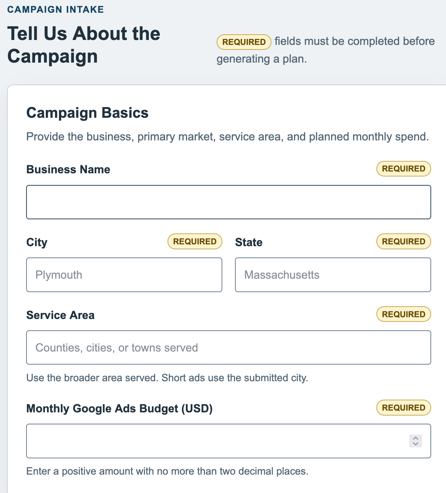
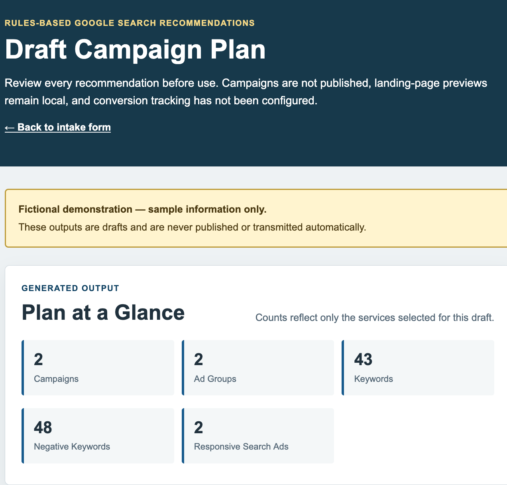
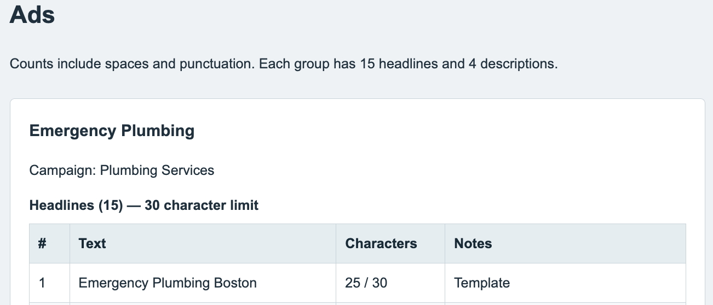
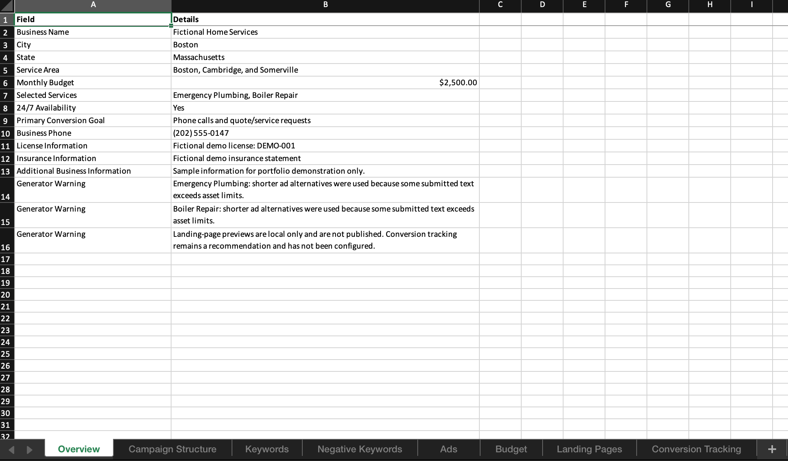
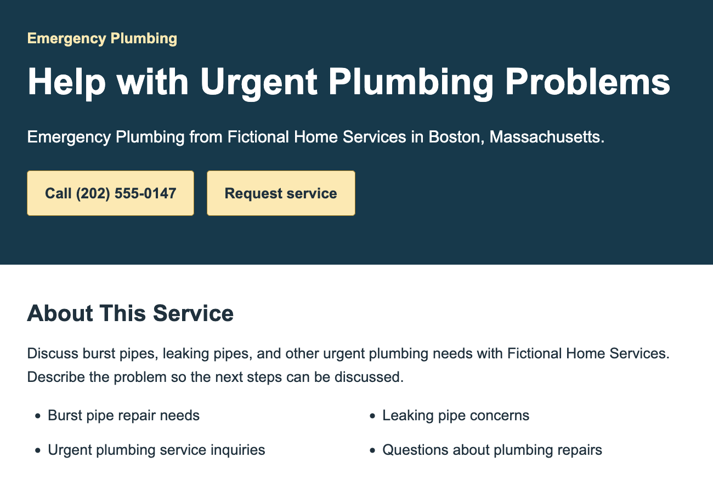
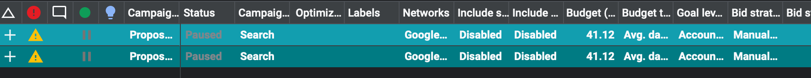

# Google Ads Campaign Generator

A local Flask application that turns validated plumbing and heating business details into a deterministic Google Search campaign draft. It provides a browser review, an eight-sheet Excel workbook, offline landing-page previews, and a paused Google Ads Editor import package.

The application uses curated local rules rather than AI or external APIs. It does not connect to Google Ads, publish campaigns, collect leads, or store submitted business information.



## Screenshots

The portfolio images use only the fixed **Fictional Home Services** demonstration. The complete approved set and privacy-review requirements are documented in [`docs/screenshots/README.md`](docs/screenshots/README.md).



Additional views: [mobile landing page](docs/screenshots/05-landing-page-mobile.png) · [extracted offline package](docs/screenshots/08-offline-package.png)

## Purpose

The project demonstrates how a structured intake can produce a reviewable paid-search plan without inventing business facts or automatically sending changes to an advertising account. It focuses on deterministic output, explicit validation, safe local exports, and clear human-review boundaries.

## Main features

- Validated intake for business, market, budget, service, goal, availability, and optional business-profile details
- Six supported plumbing and heating services
- Selected-service filtering with no empty campaigns
- Curated Phrase and Exact keywords and service-specific negatives
- Exactly 15 unique RSA headlines and 4 unique descriptions per ad group
- Character-limit checks with predefined shorter alternatives
- Calls, Forms, and Both CTA behavior
- 24/7 Yes/No wording controls
- Full-state prose with compact state abbreviations in search-style assets
- One- or two-campaign budget allocation with cent-safe rounding
- Stateless browser previews and in-memory downloads
- Formula-injection protection and safe download filenames
- Responsive layouts, skip links, landmarks, and visible keyboard focus

Supported campaign grouping:

| Campaign | Services |
|---|---|
| Plumbing Services | Emergency Plumbing, Drain Cleaning, Water Heater Repair/Replacement |
| Heating Services | Heating Repair, Boiler Repair, Furnace Repair |



## Fictional demo

Start the application and select **View Fictional Demo** on the intake page, or open `http://127.0.0.1:5000/demo`.

The demo uses fixed fictional information for **Fictional Home Services**, including a reserved example phone number and `example.com`. It selects Emergency Plumbing and Boiler Repair so both campaign branches, budget allocation, phone/form CTAs, landing-page previews, and exports can be reviewed.

The demo is prominently labeled. Its outputs are drafts, are not published or transmitted automatically, and must not be used as real business information.

## Export formats

### Excel workbook

The `.xlsx` export contains eight sheets in this order:

1. Overview
2. Campaign Structure
3. Keywords
4. Negative Keywords
5. Ads
6. Budget
7. Landing Pages
8. Conversion Tracking

Budgets are numeric currency cells. User-controlled strings are written as literal text to prevent spreadsheet formulas from executing.



### Offline landing pages

The landing-page ZIP contains an index page, one HTML file per selected service, shared local CSS, and a README. Pages work without Flask or internet access. Phone links appear only when a valid number was supplied and the selected goal allows calls. Request forms remain disabled and cannot submit or save information.



### Google Ads Editor draft

The Editor ZIP contains a UTF-8 BOM/CRLF CSV and import instructions. It includes Search campaigns, daily budgets, ad groups, keywords, negative keywords, responsive search ads, and service-specific final URLs. Campaigns and supported entities are paused by default, and campaign rows declare `EU political ads` as `No`.

The draft intentionally omits location targeting, language targeting, bidding strategy, conversion actions, tracking templates, ad schedule, and account-specific settings. Google Ads Editor may apply account defaults, so every proposed change requires manual review before posting.

Manual verification in Google Ads Editor 2.13.4 recognized 2 campaigns, 2 ad groups, 43 keywords, 48 negative keywords, and 2 responsive search ads. Both campaigns remained paused. Automatic acceptance remained off, all proposed changes were rejected after review, and nothing was posted.



## Local setup

Requirements:

- Python 3.9 or newer
- `pip`

```sh
python3 -m venv .venv
source .venv/bin/activate
python -m pip install -r requirements.txt
.venv/bin/python app.py
```

Open `http://127.0.0.1:5000`.

The local Flask entry point runs with debug mode disabled. To exercise the production server locally after installing the requirements:

```sh
PORT=8000 gunicorn app:app --bind 0.0.0.0:$PORT
```

On Windows, activate the environment with:

```powershell
.venv\Scripts\activate
python app.py
```

## Usage

1. Enter the required campaign and location details.
2. Select a goal, availability setting, and at least one service.
3. Optionally add verified phone, license, insurance, business, and website details.
4. Generate the draft and review every section.
5. Preview selected landing pages or download one of the three export formats.

All routes revalidate submitted values. Preview and export generation is stateless; no database, account, or saved “latest submission” is used.

## Live Deployment

This project is ready to run as a Render web service, but no repository or hosting account is connected by the project itself.

- The application creates campaign drafts and local landing-page previews only.
- Nothing is automatically posted, published, enabled, or launched in Google Ads.
- User submissions are processed in memory and are not intentionally stored by the application. There is no application database or submission history.
- The public `/demo` route uses fixed fictional information and is visibly labeled as a demonstration.

The included `render.yaml` provides a repeatable deployment with automatic deploys disabled. In Render, create a Blueprint from the future public repository, review the settings, and deploy only when ready. For a manually configured web service, use:

| Render setting | Value |
|---|---|
| Runtime | Python 3 |
| Build command | `pip install -r requirements.txt` |
| Start command | `gunicorn app:app --bind 0.0.0.0:$PORT` |
| Health check path | `/` |
| Auto-deploy | Off |

Render supplies `PORT`; the Gunicorn command binds the production WSGI server to that assigned port on `0.0.0.0`. No environment variables, database, persistent disk, or pre-deploy command are required. See Render’s [web-service documentation](https://render.com/docs/web-services) for the account-side setup flow.

## Testing

The project uses Python’s built-in `unittest` runner:

```sh
PYTHONDONTWRITEBYTECODE=1 .venv/bin/python -m unittest discover -s tests -v
```

Coverage includes all 63 nonempty service combinations, all goals, both availability states, keyword counts, unique RSA assets, character limits, budget rounding, business-profile normalization, HTML escaping, formula-injection protection, route isolation, Excel structure, offline ZIP safety, and Google Ads Editor CSV structure.

Manual verification covered responsive desktop and mobile layouts, keyboard navigation, Calls/Forms/Both behavior, availability wording, disabled preview forms, offline navigation with Flask stopped, Excel workbook content and numeric budget formatting, all three downloads, and direct-preview redirect behavior. Google Ads Editor 2.13.4 imported the fictional draft without errors or warnings in its import summary; both campaigns remained paused, all proposed changes were rejected, and nothing was posted.

See [`docs/development-history.md`](docs/development-history.md) for the implementation history.

## Project structure

```text
app.py                         Flask routes and shared results rendering
validation.py                  Intake normalization and validation
business_profile.py            Optional profile and phone validation
website.py                     Website-origin and final-URL validation
rules_library.py               Service, keyword, ad, and location templates
campaign_reference_data.py     Curated negatives and conversion templates
generator.py                   Deterministic campaign generation
excel_export.py                Eight-sheet in-memory Excel export
landing_pages.py               Landing-page content generation
landing_page_export.py         Offline landing-page ZIP export
google_ads_editor_export.py    Google Ads Editor draft export
demo_data.py                   Fixed fictional portfolio data
templates/                     Jinja templates
static/                        Isolated application and preview CSS
tests/                         unittest suite
docs/                          Portfolio history and screenshot guidance
scripts/build_release.py       Allowlisted release-package builder
render.yaml                    Repeatable Render web-service configuration
```

## Safety and limitations

- Every generated campaign is a draft requiring qualified human review.
- Nothing is automatically uploaded, enabled, launched, or posted to Google Ads.
- Conversion tracking rows are recommendations; no tracking is configured.
- Landing pages are local previews and are not deployed websites.
- Disabled request forms do not collect or save leads.
- User-provided business details are displayed as supplied and are not independently verified.
- Website validation confirms syntax only. It does not prove ownership, availability, policy compliance, or the existence of generated paths.
- The project does not guarantee Google Ads approval, campaign performance, lead volume, revenue, or return on ad spend.
- Account targeting, bidding, conversion actions, schedules, and other account-specific settings must be configured and verified before use.

## License

Licensed under the [MIT License](LICENSE).
